# Awesome On-Device AI & Edge Inference Runtime 🚀⚡

  

  
  
  
  
  

> 🌟 **A curated directory of top On-Device AI and Edge Inference Runtime platforms** — featuring commercial managed inference solutions and high-performance open-source runtimes for running foundation models, LLMs, vision, and speech models locally on laptops, desktops, microcontrollers, mobile devices, and edge hardware.
>
> 💡 *Star this repository if you find it helpful for your edge AI workflows!*

---

## 📑 Table of Contents
- [🌐 Sector Overview & Market Dynamics](#-sector-overview--market-dynamics)
- [🟦 SaaS / Hosted Platforms](#-saas--hosted-platforms)
- [🟩 Open-Source Software](#-open-source-software)
  - [Ollama](#-ollama)
  - [llama.cpp](#-llamacpp)
  - [vLLM](#-vllm)
  - [whisper.cpp](#-whispercpp)
  - [LocalAI](#-localai)
  - [Exo](#-exo)
  - [Jan](#-jan)
  - [llamafile](#-llamafile)
  - [MLC-LLM](#-mlc-llm)
  - [WebLLM](#-webllm)
  - [mlx-serve](#-mlx-serve)
  - [TrnRT](#-trnrt)
- [📊 Feature Comparison Matrix](#-feature-comparison-matrix)
- [📈 Star History](#-star-history)
- [💖 Support & Sponsorship](#-support--sponsorship)
- [🤝 Contributing](#-contributing)
- [📄 License](#-license)

---

## 🌐 Sector Overview & Market Dynamics

The global Edge AI & Inference market is estimated at approximately **$21 Billion to $47 Billion**, rapidly accelerating at a compound annual growth rate (CAGR) of **17% to 32%** toward several hundred billion dollars over the next decade. 

The sector is **moderately to heavily fragmented** across diverse edge form factors, microarchitectures (CPUs, GPUs, NPUs, and DSPs), and heterogeneous quantization runtimes (GGUF, ONNX, MLX, and TensorRT), while hardware silicon and cloud offload channels remain concentrated among leading semiconductor giants and hyperscale platforms.

---

## 🟦 SaaS / Hosted Platforms

Commercial and cloud-managed inference platforms designed to complement on-device development, offload heavy reasoning models, and bridge edge devices with managed API acceleration.

| Platform | Valuation / Revenue Scale | Starting Pricing | Free Tier Limit | Primary Focus & Highlights |
| :--- | :--- | :--- | :--- | :--- |
| **Together AI** | **$8.3B Valuation** (~$1.15B ARR) | **$0.14 per 1M tokens** (Serverless inference; $15 minimum initial credit purchase) | **No perpetual free tier** (Requires minimum $15 initial credit reload to test models) | Ultra-fast cloud inference, fine-tuning, and dedicated GPU clusters for open-source foundation models. |
| **Groq** | **$3.5B Valuation** ($350M Series D) | **$0.075 per 1M tokens** (Pay-as-you-go developer API) | **Free evaluation tier** (Strict limits: 200,000 tokens/day cap with model-specific TPM/RPM rate limits) | Deterministic LPU inference engine engineered for ultra-low latency real-time LLM token generation. |
| **Modular** | **$1.6B Valuation** (~$10M–$50M ARR) | **$0.0001 per 1k compute units** (MAX Engine developer pay-as-you-go) | **Free Community Tier** (Includes single-developer MAX engine local evaluation with community forum support) | Next-gen AI compiler and runtime infrastructure powered by Mojo and MAX Engine across diverse hardware. |
| **Ollama Cloud** | **$500M+ Est. Valuation** (Top venture-backed AI startup) | **$20.00 / month** (Pro plan with $60 monthly compute credit pool) | **Free starter tier** ($0/month with basic starter model credits and a 3 concurrent request cap) | Seamlessly offloads heavy foundation models from the local Ollama CLI to managed cloud infrastructure. |
| **LM Studio** | **$100M+ Est. Valuation** ($19M funding, ~$2M–$4.5M ARR) | **$20.00 / month** (Bionic+ plan for cloud-hosted open models & web search) | **Free forever plan** (Free for personal and commercial local use; unlimited offline local inference via llama.cpp/MLX) | Polished desktop GUI and local OpenAI-compatible API server featuring multi-device model offloading via LM Link. |

---

## 🟩 Open-Source Software

Curated community-driven, self-hosted, and embedded on-device inference runtimes and edge frameworks, ordered by GitHub star count:

### 🦙 Ollama
  
**Repository:** [ollama/ollama](https://github.com/ollama/ollama) | **Stack:** Go / llama.cpp / C++ | **License:** MIT  
Ollama is the premier open-source tool for running large language models locally. It provides a clean single-binary installation, an integrated model registry, and a drop-in OpenAI-compatible REST API. Ollama operates completely offline once models are downloaded and is standard across macOS, Windows, and Linux.  
**Best For:** Developers looking for the fastest, simplest path to running open LLMs locally with zero configuration.

### ⚡ llama.cpp
  
**Repository:** [ggml-org/llama.cpp](https://github.com/ggml-org/llama.cpp) | **Stack:** C / C++ | **License:** MIT  
The foundational C/C++ inference engine created by Georgi Gerganov that pioneered modern consumer-grade LLM quantization (GGUF). Features zero dependencies, first-class Apple Silicon Metal acceleration, AVX/AVX2/AVX-512 CPU acceleration, and CUDA/ROCm/Vulkan support across desktop and edge devices.  
**Best For:** Low-level edge deployments, embedded systems, custom runtime builds, and maximum efficiency per watt.

### 🚀 vLLM
  
**Repository:** [vllm-project/vllm](https://github.com/vllm-project/vllm) | **Stack:** Python / CUDA / C++ | **License:** Apache-2.0  
vLLM is an open-source library for high-throughput and memory-efficient LLM serving. Powered by PagedAttention, chunked prefill, and speculative decoding, vLLM sets the benchmark for edge GPU servers and on-premise production inference clusters.  
**Best For:** High-throughput batch inference, GPU clusters, and production self-hosted OpenAI-compatible microservices.

### 🎙️ whisper.cpp
  
**Repository:** [ggml-org/whisper.cpp](https://github.com/ggml-org/whisper.cpp) | **Stack:** C / C++ | **License:** MIT  
High-performance inference engine for OpenAI's Whisper speech recognition model in pure C/C++. Optimized for low memory footprint and real-time audio transcription directly on mobile, Raspberry Pi, and edge microcontrollers.  
**Best For:** On-device voice interfaces, real-time audio transcription, and offline embedded speech processing.

### 🤖 LocalAI
  
**Repository:** [mudler/LocalAI](https://github.com/mudler/LocalAI) | **Stack:** Go / C++ / Multi-backend | **License:** MIT  
LocalAI serves as a drop-in replacement REST API compatible with OpenAI specifications for local inference. It unifies text generation, image generation, audio synthesis, and embeddings across multiple backends (llama.cpp, Whisper, Stable Diffusion) without requiring cloud keys.  
**Best For:** Teams wanting a self-hosted, multi-modal drop-in replacement for OpenAI endpoints running on consumer hardware.

### 🌐 Exo
  
**Repository:** [exo-explore/exo](https://github.com/exo-explore/exo) | **Stack:** Python / MLX / PyTorch | **License:** GPL-3.0  
Exo decentralizes AI cluster computing by pooling consumer-grade hardware (such as multiple MacBooks, iPads, or mixed-vendor machines) into a distributed GPU cluster to run massive models that exceed individual device RAM limits.  
**Best For:** Users wanting to combine existing everyday devices to run 70B+ parameter models without buying enterprise server hardware.

### 🧠 Jan
  
**Repository:** [janhq/jan](https://github.com/janhq/jan) | **Stack:** TypeScript / C++ / Electron | **License:** Apache-2.0  
Jan is an open-source, offline-first alternative to ChatGPT and Claude. It runs 100% locally on your machine, supports Model Context Protocol (MCP) servers, includes autonomous local agent tools, and exposes an internal OpenAI-compatible local server.  
**Best For:** Everyday users wanting a privacy-focused local desktop assistant with native MCP tools and agent workflows.

### 📦 llamafile
  
**Repository:** [mozilla-ai/llamafile](https://github.com/mozilla-ai/llamafile) | **Stack:** C++ / Cosmopolitan Libc | **License:** Apache-2.0  
Maintained by Mozilla AI, llamafile lets you turn LLM weights into single multi-OS executable binaries. Built with Cosmopolitan Libc, a single file runs on Linux, macOS, Windows, FreeBSD, OpenBSD, and NetBSD without installation or container overhead.  
**Best For:** Zero-dependency model distribution, single-binary distribution, and offline educational use.

### 📱 MLC-LLM
  
**Repository:** [mlc-ai/mlc-llm](https://github.com/mlc-ai/mlc-llm) | **Stack:** Python / C++ / Apache TVM | **License:** Apache-2.0  
Machine Learning Compilation for LLMs (MLC-LLM) is a universal deployment engine that compiles language models directly into hardware-native runtimes for iOS, Android, WebGPU, and edge GPUs using Apache TVM.  
**Best For:** Cross-platform edge mobile deployment (native iOS & Android apps) with hardware-specific compiler optimizations.

### 🕸️ WebLLM
  
**Repository:** [mlc-ai/web-llm](https://github.com/mlc-ai/web-llm) | **Stack:** TypeScript / WebGPU | **License:** Apache-2.0  
WebLLM brings high-performance foundation model inference directly into the web browser using WebGPU hardware acceleration. It requires zero server-side compute and operates 100% client-side with complete privacy.  
**Best For:** Web application developers building private, zero-server-cost AI features directly inside client web browsers.

### 🍏 mlx-serve
  
**Repository:** [ddalcu/mlx-serve](https://github.com/ddalcu/mlx-serve) | **Stack:** Python / Apple MLX | **License:** MIT  
A headless local inference server built specifically for Apple Silicon and Apple MLX. Features hot-swapping of models on demand, unified memory management, prompt caching, and an OpenAI-compatible REST server.  
**Best For:** Mac studio and MacBook users desiring dedicated, headless MLX model serving with minimal idle memory consumption.

### ⚙️ TrnRT
  
**Repository:** [RunanywhereAI/trnrt](https://github.com/RunanywhereAI/trnrt) | **Stack:** Python / AWS Trainium / NKI | **License:** Apache-2.0  
TrnRT is an open inference engine engineered specifically for large language models running on AWS Trainium chips (such as `trn2` instances). Employs Neuron Kernel Interface (NKI) megakernels and FP8 KV-cache prefix management.  
**Best For:** Enterprise teams looking for open-source high-throughput inference on specialized AWS Trainium accelerators.

---

## 📊 Feature Comparison Matrix

| Project | License | Hardware Target | Architecture | Local Offline | Multi-Device Clustering | OpenAI API Compatible |
| :--- | :--- | :--- | :--- | :---: | :---: | :---: |
| **Ollama** | MIT | CPU / NVIDIA / AMD / Apple | Desktop / Server | ✅ Yes | ❌ No | ✅ Yes |
| **llama.cpp** | MIT | CPU / Metal / CUDA / Vulkan | Embedded / Desktop | ✅ Yes | ❌ No | ✅ Yes |
| **vLLM** | Apache-2.0 | NVIDIA / AMD / TPU | Cloud / Edge Server | ✅ Yes | ✅ Yes | ✅ Yes |
| **whisper.cpp** | MIT | CPU / Metal / CUDA / CoreML | Embedded / Mobile | ✅ Yes | ❌ No | ❌ No |
| **LocalAI** | MIT | CPU / GPU / Heterogeneous | Self-Hosted Server | ✅ Yes | ❌ No | ✅ Yes |
| **Exo** | GPL-3.0 | Apple Silicon / Mixed Devices | Peer-to-Peer Cluster | ✅ Yes | ✅ Yes | ✅ Yes |
| **Jan** | Apache-2.0 | CPU / GPU / Apple Silicon | Desktop App | ✅ Yes | ❌ No | ✅ Yes |
| **llamafile** | Apache-2.0 | Multi-OS Portable Binary | Portable Executable | ✅ Yes | ❌ No | ✅ Yes |
| **MLC-LLM** | Apache-2.0 | iOS / Android / WebGPU / GPU | Native Mobile / Edge | ✅ Yes | ❌ No | ✅ Yes |
| **WebLLM** | Apache-2.0 | Browser (WebGPU) | Client-Side Web | ✅ Yes | ❌ No | ✅ Yes |
| **mlx-serve** | MIT | Apple Silicon (MLX) | Headless Server | ✅ Yes | ❌ No | ✅ Yes |
| **TrnRT** | Apache-2.0 | AWS Trainium (NKI) | Cloud / Edge Accelerator | ✅ Yes | ❌ No | ✅ Yes |

---

## 📈 Star History

---

## 💖 Support & Sponsorship

Thank you so much for exploring and supporting this curated resource! If you find this project valuable for your local AI, edge runtime, or on-device intelligence workflows, here are a few wonderful ways you can show support:

- 🌟 **Star this repository** to help others discover edge AI and local inference tooling.
- 🍴 **Fork the repo** to contribute your own favorite open-source runtimes, engines, and benchmarks.
- 📢 **Share this list** with fellow developers, researchers, and AI builders on social media, Discord, or your team chats.
- ☕ **Buy me a coffee / Sponsor the project:** Your support directly fuels the research and maintenance of this list. Support my work via my [GitHub Sponsor Dashboard](https://github.com/sponsors/ishandutta2007):

  

---

## 🤝 Contributing

Contributions are welcomed! If you know of an edge inference runtime, mobile deep learning compiler, or on-device LLM platform that should be included:

1. Fork this repository.
2. Add the framework or engine with relevant tags, stack information, and license details.
3. Submit a Pull Request with a clear description of the project.

---

## 📄 License

This repository and curated list are released under the [CC0 1.0 Universal](https://creativecommons.org/publicdomain/zero/1.0/) (Public Domain Dedication). Individual software platforms retain their own respective copyrights and licenses.

---

  ⭐ <b>If you find this directory valuable, please star this repository!</b> ⭐

